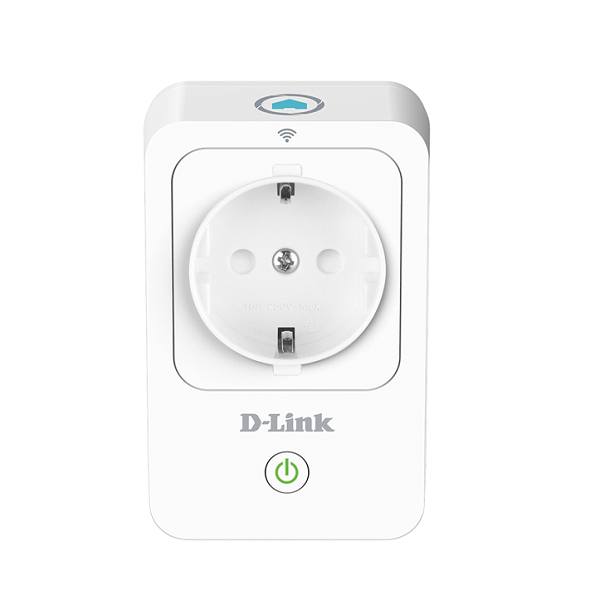

# ioBroker.mydlink

**Tests:** 

myDlink Adapter for ioBroker. 
------------------------------------------------------------------------------

Allows to control power sockets or motion detectors from [D-Link](https://eu.dlink.com/uk/en/for-home/smart-home) from within ioBroker. *mydlink* is a registered trademark of D-Link. This Software is developed by the ioBroker community and is not owned or controlled by D-Link. 

**This adapter uses Sentry libraries to automatically report exceptions and code errors to the developers.** For more details and for information how to disable the error reporting see [Sentry-Plugin Documentation](https://github.com/ioBroker/plugin-sentry#plugin-sentry)! Sentry reporting is used starting with js-controller 3.0.
This also helps with supporting new devices.

Currently tested devices:

| Model | Type  | Image |
| :---: | :---: | :---: |
| DSP-W215 | Smart Plug (socket, temperature, current) **Needs polling** |  |
| DSP-W115 | Smart Plug (socket) |  | 
| DCH-S150 | Motion Detector (last motion detected) **Needs polling** |  |

The adapter needs to poll some devices. Newer ones do send push messages, which is now supported. Sensor readings and motion detection will be 
delayed by polling interval, if they need to be polled (can be set in config).

#### Configuration:
* List of devices, each device with following settings:

<table>
<tr><td>Name</td><td>set a name here, must be unique (for mydlink devices)</td></tr>
<tr><td>IP</td><td>fill in IP address here, hostname should also work</td></tr>
<tr><td>PIN</td><td>PIN is printed on a sticker on the device, probably at the bottom. Can be TELNET for DSP-W115, see below.</td></tr>
<tr><td>Poll interval</td><td>per device poll interval  Set 0 to disable polling.  <b>Recommendation:</b> Set a fast poll interval for sensors and a longer one for plugs.</td></tr>
<tr><td>enable</td><td>if not enabled, will not be polled or controlled.  Devices that are not plugged in can be disabled to avoid network traffic and error messages in the log.</td></tr>
</table>

The adapter does not interfere with the use of the app.

## Setup of DSP-W115

DSP-W115 and other *newer* devices use a completely different protocol and a different setup. There are two ways to use them.

1. Use App and Adapter at the same time:
  If you want to keep using the app, you have to put the device into factory mode, following this procedure:
  1. Reset device into recovery mode by holding the wps/reset button during boot until it starts blinking **red** instead of orange.
  2. Now a telnet deamon is running, connect to the device wifi
  3. Run `telnet 192.168.0.20` and login with `admin:123456` (or use putty, don't forget to select `telnet` instead of `ssh`).
  4. Run `nvram_set FactoryMode 1`
  5. Run `reboot; exit;` to reboot the device.
  6. Now you should enter `TELNET` as Pin, and the adapter will retrieve the required data from the device itself.
2. Don't want to use the App
  1. Remove the device from the app, this will reset the device
  2. Start setup in the app again and configure your Wifi on the device.
  3. Now the device will reoobt and connect to your Wifi. During that time **close** the app, make sure it is really closed.
  4. Now the device should be connected to your Wifi and not connected to the app, so that the PIN from the sticker will work in the adapter.
  (If the device does not connect to your wifi or the device does not accept login via the PIN please try again. Press the button on the device until it lights up red in order to reset.)

## Changelog
<!-- 
	Placeholder for next versions (this needs to be indented):
	### **WORK IN PROGRESS**
-->
### **WORK IN PROGRESS**
- (Garfonso) feat: sensitivity, backoff time and detection of motion detectors can be changed with states
- (Garfonso) feat: NTP server of older devices (DSP-W215, DCH-S150) can be set in the device manager
- (Garfonso) feat: devices are polled right after start

### 2.0.0 (2026-10-11)
- (copilot) **Breaking:** Adapter requires node.js >= 22 now
- (Garfonso) **Breaking:** Adapter requires js-controller >= 7.0.7 and admin >= 8.0.14 now
- (Garfonso) **Breaking:** PINs are encrypted by js-controller and hidden from other adapters. The configuration is converted on first start, the adapter restarts once. After a downgrade to 1.3.x the PINs have to be entered again.
- (Garfonso) feat: devices are added, edited, enabled / disabled and deleted in the device manager
- (Garfonso) feat: settings page uses jsonConfig and embeds the device manager (#594, #414)
- (Garfonso) fix: adapter did crash on invalid data from websocket devices (#384)
- (Garfonso) fix: auto detection did not work on Linux (replaced mdns-discovery with multicast-dns)
- (Garfonso) fix: total power consumption was written to currentPower
- (Garfonso) fix: log in again if session of a device expired
- (Garfonso) fix: polling can be disabled for devices with known model
- (Garfonso) fix: normalize MAC addresses, fixes endless loop if another device answers on the configured IP
- (Garfonso) fix: detect changed IP of devices and update the configuration
- (Garfonso) fix: websocket devices were reported reachable while offline
- (Garfonso) fix: websocket devices reconnect after they were offline (dlink_websocketclient 0.6.2)
- (Garfonso) fix: pause login of websocket devices for 10 minutes if they refuse it or the PIN is wrong (device locks itself after 10 invalid tokens)
- (Garfonso) fix: no new timers during unload
- (Garfonso) chore: reduced log noise
- (Garfonso) chore: tested with node.js 26 (#632)
- (Garfonso) chore: dependencies updated

### 1.3.6 (2024-05-24)
* fixed: crash with empty pin.

### 1.3.5 (2023-10-30)
* fixed: wrong type warnings with legacy devices

### 1.3.4 (2023-08-18)
* fixed: missing build...

### 1.3.3 (2023-08-07)
* fix: crash with js-controller 5.x

[Older changelogs can be found there](CHANGELOG_OLD.md)

## License
MIT License

Copyright (c) 2026 iobroker-community-adapters <iobroker-community-adapters@gmx.de>  
Copyright (c) 2024-2025 Garfonso <garfonso@mobo.info>

Permission is hereby granted, free of charge, to any person obtaining a copy
of this software and associated documentation files (the "Software"), to deal
in the Software without restriction, including without limitation the rights
to use, copy, modify, merge, publish, distribute, sublicense, and/or sell
copies of the Software, and to permit persons to whom the Software is
furnished to do so, subject to the following conditions:

The above copyright notice and this permission notice shall be included in all
copies or substantial portions of the Software.

THE SOFTWARE IS PROVIDED "AS IS", WITHOUT WARRANTY OF ANY KIND, EXPRESS OR
IMPLIED, INCLUDING BUT NOT LIMITED TO THE WARRANTIES OF MERCHANTABILITY,
FITNESS FOR A PARTICULAR PURPOSE AND NONINFRINGEMENT. IN NO EVENT SHALL THE
AUTHORS OR COPYRIGHT HOLDERS BE LIABLE FOR ANY CLAIM, DAMAGES OR OTHER
LIABILITY, WHETHER IN AN ACTION OF CONTRACT, TORT OR OTHERWISE, ARISING FROM,
OUT OF OR IN CONNECTION WITH THE SOFTWARE OR THE USE OR OTHER DEALINGS IN THE
SOFTWARE.
